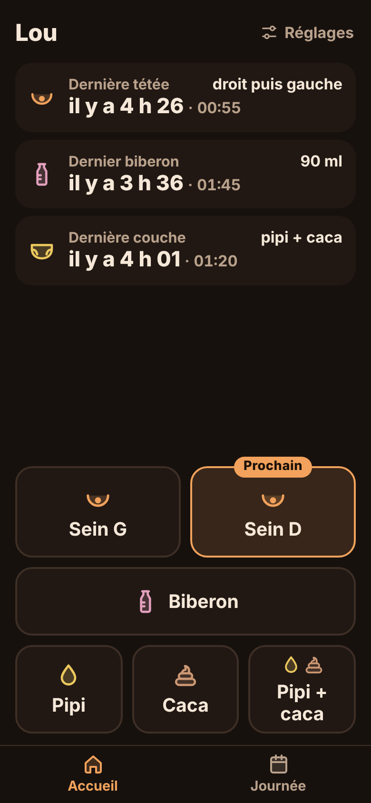
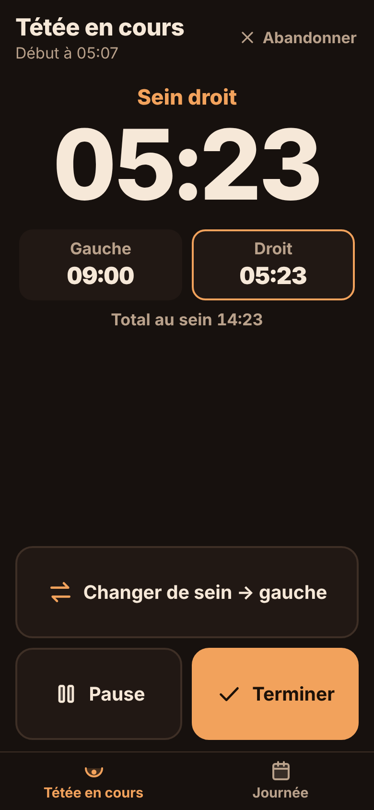
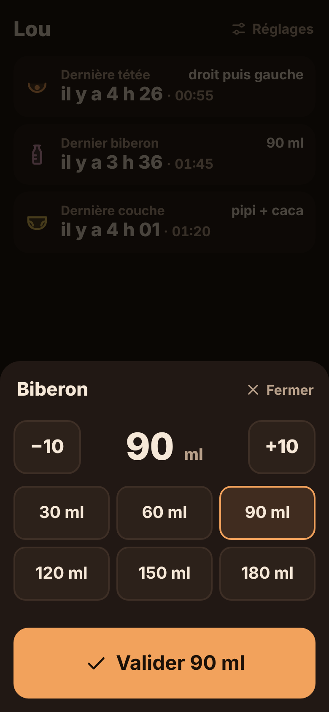
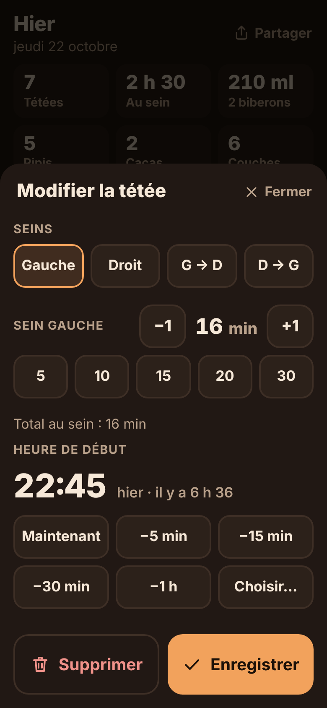

# Veilleuse

PWA de suivi d'un nouveau-né : tétées, biberons et couches. Pensée pour une
maman épuisée, la nuit, d'une seule main : chaque saisie prend une ou deux
pressions, sans jamais ouvrir de clavier. Aucun compte, aucun serveur, tout
reste sur le téléphone et fonctionne en mode avion.

**En ligne : https://dotcomya.github.io/media/** (GitHub Pages, branche `gh-pages`).

| Accueil | Tétée en cours | Biberon | Journée | Correction |
|---|---|---|---|---|
|  |  |  |  |  |

## Ce que fait l'app

| Action | Pressions |
|---|---|
| Pipi, caca ou « Pipi + caca » | 1 (toast « Enregistré · Annuler » pendant 5 s) |
| Biberon à la quantité habituelle | 2 (Biberon → Valider ; la dernière quantité est présélectionnée) |
| Démarrer une tétée | 1 (Sein G ou Sein D ; le sein opposé au dernier utilisé porte la mention « Prochain ») |
| Changer de sein | 1 |
| Pause (rot, change) / Reprendre | 1 |
| Terminer | 1 (au-delà de 60 min, l'app propose d'ajuster la durée) |
| Tétée oubliée | 2 (Journée → « Oubli sein G » ou « Oubli sein D » → « Il y a 30 min »…) |

- **Bandeau d'état** en haut de l'accueil, rafraîchi en continu : dernière
  tétée (comptée depuis son **début**), dernier biberon, dernière couche.
- **Chrono fiable** : il ne repose que sur des horodatages enregistrés en base.
  App fermée, téléphone verrouillé ou redémarré : à la réouverture, la tétée en
  cours reprend avec le bon temps.
- **Journée** : résumé (tétées, temps au sein, ml de biberon, pipis, cacas,
  couches), puis timeline. Navigation par balayage ou par les boutons
  Veille / Lendemain.
- **Correction** : toucher une entrée pour la modifier ou la supprimer. L'heure
  se règle par puces (« Maintenant », « −5 min », « −15 min », « −30 min »,
  « −1 h », cumulables), avec la roue native du téléphone en dernier recours.
  Tétée oubliée : « Oubli sein G » / « Oubli sein D », puis l'heure (« Il y a
  15 min » à « Il y a 2 h », ou « Autre heure… ») ; la durée reste « non
  notée » et peut être complétée en touchant l'entrée. « Autre oubli » pour un
  biberon ou une couche.
- **Partage** (en haut de la Journée) : résumé texte du jour via la feuille de partage du téléphone,
  pour le pédiatre ou la sage-femme. Export CSV de toutes les données dans
  Réglages (séparateur `;`, s'ouvre directement dans Excel en français).
- Mode sombre chaud par défaut, mode clair dans Réglages ; prénom du bébé
  facultatif ; vibration à chaque saisie sur Android (Safari iOS ne la gère pas).

## Lancer en local

Prérequis : Node.js 22.12 ou plus.

```bash
cd veilleuse
npm install
npm run dev        # serveur de développement : http://localhost:5173
npm test           # tests unitaires (chrono, résumé journalier, formats)
npm run build      # vérification TypeScript + build de production dans dist/
npm run preview    # sert dist/ : http://localhost:4173 (service worker actif)
```

Le service worker n'est enregistré qu'en production : testez le mode hors
ligne avec `npm run build && npm run preview`.

`npm run icons` régénère les icônes et les écrans de lancement iOS
(`scripts/icons.mjs`, sans dépendance).

## Déployer

L'app est un site statique (`dist/`). Elle se trouve dans le sous-dossier
`veilleuse/` du dépôt : c'est le seul réglage à indiquer à l'hébergeur.

### GitHub Pages (version en ligne actuelle)

La branche `gh-pages` contient uniquement le contenu de `dist/`. Pour publier
une nouvelle version :

```bash
cd veilleuse
npm run build
touch dist/.nojekyll
cd dist && git init -b gh-pages && git add -A && git commit -m "Publie Veilleuse"
git push -f https://github.com/dotcomya/media gh-pages
rm -rf .git
```

Garder la même adresse : les données sont liées à l'origine du site, en changer
reviendrait à repartir d'un historique vide.

### Netlify

- **Depuis l'interface** : *Add new site → Import an existing project*,
  choisir le dépôt, puis **Base directory : `veilleuse`**. La commande et le
  dossier de publication sont lus dans `netlify.toml`.
- **En ligne de commande** :
  ```bash
  cd veilleuse
  npm run build
  npx -p netlify-cli netlify deploy --prod --dir=dist
  ```

### Vercel

- **Depuis l'interface** : *Add New → Project*, choisir le dépôt, puis
  **Root Directory : `veilleuse`**. Le reste est lu dans `vercel.json`.
- **En ligne de commande** :
  ```bash
  cd veilleuse
  npx vercel --prod
  ```

Les deux configurations servent `sw.js` en `no-cache` : chaque nouvelle
version est téléchargée en arrière-plan et prise au lancement suivant.

## Installer sur l'écran d'accueil d'un iPhone

1. Ouvrir l'adresse du site dans **Safari** (connexion internet requise cette
   première fois).
2. Toucher le bouton **Partager** (le carré avec une flèche vers le haut, en
   bas de l'écran).
3. Faire défiler et choisir **« Sur l'écran d'accueil »**. Si l'option
   n'apparaît pas, toucher « Modifier les actions… » pour l'ajouter.
4. Garder le nom « Veilleuse » (et, si l'option « Ouvrir en tant qu'app web »
   est proposée, la laisser activée), puis toucher **Ajouter**.
5. Ouvrir l'app depuis la nouvelle icône : elle s'affiche en plein écran, sans
   barre Safari.
6. Pour vérifier le hors-ligne : activer le mode avion et rouvrir l'app.

À savoir :

- Les données de l'app installée sont **séparées** de celles de Safari. Toujours
  utiliser l'icône de l'écran d'accueil.
- **Supprimer l'icône supprime aussi les données.** Pensez à exporter le CSV de
  temps en temps (Réglages → Exporter tout en CSV → Enregistrer dans Fichiers).
- Safari peut effacer les données d'un site non visité depuis 7 jours ; iOS
  n'applique pas cette règle aux apps installées sur l'écran d'accueil.
  Installez donc l'app plutôt que de l'utiliser dans un onglet.

### Sur Android (Chrome)

Ouvrir le site dans Chrome, puis menu **⋮ → Installer l'application** (ou
« Ajouter à l'écran d'accueil »).

## Modèle de données

Stockage local IndexedDB (base `veilleuse`, via [`idb`](https://github.com/jakearchibald/idb)),
avec demande de stockage persistant (`navigator.storage.persist()`).

**Store `events`**, clé `id`, index `at` et `updatedAt` :

| Champ | Type | Rôle |
|---|---|---|
| `id` | UUID v4 | identifiant stable, prêt pour une synchro |
| `type` | `'breast'` \| `'bottle'` \| `'diaper'` | |
| `at` | ms epoch | heure de l'événement (début pour une tétée) |
| `createdAt`, `updatedAt` | ms epoch | traçabilité, résolution de conflits |
| `deletedAt` | ms epoch \| `null` | suppression logique |
| `sides` | `('L' \| 'R')[]` | tétée : seins dans l'ordre d'usage ; le dernier détermine le « Prochain » |
| `leftMs`, `rightMs`, `durationMs` | ms | tétée : durée par sein et totale, pauses exclues |
| `ml` | nombre | biberon |
| `pee`, `poop` | booléens | couche (les deux à `true` pour une couche mixte) |

**Store `kv`** : `activeFeed` (tétée en cours : sein actuel, seins utilisés,
début du segment en cours ou `null` en pause, temps cumulés par sein) et
`settings` (prénom, dernière quantité de biberon). Le thème est gardé dans
`localStorage` pour s'appliquer avant le premier affichage.

## Arborescence

```
veilleuse/
├── index.html              métadonnées PWA/iOS, thème appliqué avant rendu
├── vite.config.ts          build + plugin qui génère dist/sw.js
├── netlify.toml, vercel.json
├── public/                 manifeste, icônes, écrans de lancement iOS
├── scripts/icons.mjs       génération des PNG (Node pur)
├── docs/                   captures d'écran
└── src/
    ├── main.tsx            montage, enregistrement du service worker
    ├── sw.js               service worker (modèle complété au build)
    ├── model.ts            types, UUID, création d'événements
    ├── db.ts               accès IndexedDB
    ├── store.ts            état de l'app et actions (enregistrer, annuler…)
    ├── hooks.ts            useNow : horloge rafraîchie
    ├── styles.css
    ├── lib/
    │   ├── feeding.ts      logique pure du chrono          (+ feeding.test.ts)
    │   ├── summary.ts      résumé journalier               (+ summary.test.ts)
    │   ├── format.ts       formats FR, 24 h                (+ format.test.ts)
    │   ├── time.ts         bornes de journée (changement d'heure inclus)
    │   ├── csv.ts, share.ts, theme.ts, haptics.ts
    └── components/
        ├── App.tsx         onglets Accueil / Journée
        ├── Home.tsx        bandeau d'état + grille de gros boutons
        ├── FeedMode.tsx    tétée en cours, ajustement au-delà de 60 min
        ├── ForgottenFeedSheet.tsx  tétée oubliée : sein puis heure
        ├── BottleSheet.tsx, DayView.tsx, EditSheet.tsx, SettingsSheet.tsx
        └── BottlePicker, DurationPicker, TimeChips, Sheet, Toast, TopBar, Icon
```

## Choix techniques

- **Preact** plutôt que React : même API pour ~4 ko. Seules dépendances
  d'exécution : `preact` et `idb`. Bundle complet : environ 17 ko compressé.
- **Service worker sans Workbox** : un petit plugin Vite (`vite.config.ts`)
  injecte la liste des fichiers à précharger et une version calculée à partir
  de leur contenu. Stratégie « cache d'abord » : l'app s'ouvre instantanément
  et hors ligne.
- **Pas de flash blanc** : fond sombre posé dans `index.html` avant tout
  chargement, `background_color` du manifeste et écrans de lancement iOS
  sombres pour les iPhone récents.
- Toutes les actions principales sont dans la moitié basse de l'écran ; les
  actions destructrices (« Abandonner ») sont en haut, et toujours annulables.

## Vérifications effectuées

- 22 tests unitaires (`npm test`) : chrono (changements de sein, pauses,
  reprise après fermeture, horloge remise en arrière, détection > 60 min, sein
  suggéré) et résumé journalier (bornes de minuit, entrées supprimées, jour de
  25 h du passage à l'heure d'hiver).
- Scénario de bout en bout dans Chromium (Playwright, émulation mobile) :
  nombre de pressions de chaque critère d'acceptation, annulation, reprise du
  chrono après rechargement, ajustement d'une tétée oubliée, fonctionnement
  hors ligne, données conservées après fermeture complète du navigateur.
- Rendu contrôlé en **390 × 844** et **360 × 740**, sans défilement sur
  l'accueil, le mode tétée (y compris en pause) et la journée. Capture en
  360 × 740 : [docs/accueil-360.png](docs/accueil-360.png).

Ces vérifications ont été faites sur un Chromium émulé, pas sur un iPhone ou
un téléphone Android physique : un essai réel (installation, mode avion,
redémarrage du téléphone) reste à faire avant de s'y fier la nuit.

## Hors périmètre de la V1

Comptes, synchronisation entre téléphones, notifications, graphiques, conseils
médicaux. Le modèle (UUID, `createdAt` / `updatedAt`, `deletedAt`, index
`updatedAt`) est prêt pour ajouter une synchronisation plus tard.
