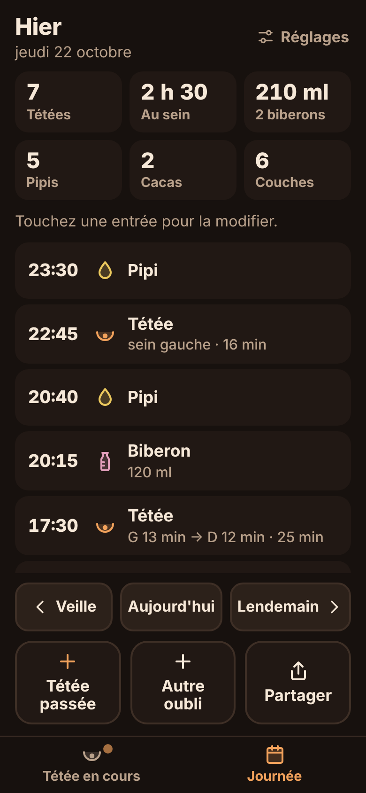

# Nous 3

PWA de suivi d'un nouveau-né, pour deux parents, pensée pour la nuit et une
seule main. Une seule page, très simple : **une ligne = un moment avec bébé**
(l'heure, puis 🤱 tétée, 🍼 biberon, 💧 pipi, 💩 caca), et à côté de chaque
ligne, **l'heure du prochain repas**. Tout reste sur le téléphone et fonctionne
en mode avion ; le partage entre parents passe par un petit serveur.

**Marque** : le logo réunit deux parents (terracotta, pêche) et un bébé (sauge),
blottis ; tons chauds, titres en police arrondie (SF Pro Rounded sur iPhone).
Le code vit dans le dossier `veilleuse/` (ancien nom de travail).

**En ligne : https://dotcomya.github.io/media/** (GitHub Pages, branche `gh-pages`).



## Ce que fait l'app

- **Une page = un jour** : « Aujourd'hui · vendredi 23 octobre », et le bandeau
  des jours pour passer aux jours précédents (ou un balayage sur la liste).
- **La liste du jour**, en trois colonnes : **Heure**, **Quoi** (les emojis,
  chacun toujours à la même place), **Prochain repas**.
- **Prochain repas** = dernière tétée ou dernier biberon jusqu'à cette ligne
  + 2 h 30. La ligne la plus récente est mise en avant avec « dans 1 h 10 », en
  rouge si l'heure est passée.
- **Saisir** (en bas) : on coche ce qui vient de se passer (pipi et caca
  ensemble : on coche les deux), puis **Valider**. **Biberon** : un curseur de
  10 en 10 ml (10 à 250 ml), réglé sur le dernier volume donné ; le volume
  s'affiche ensuite sous le 🍼. **Heure** : l'encart à gauche de Valider dit
  « Maintenant » ; en cas de saisie en retard, on le touche pour choisir l'heure.
- **⏰ Réveil, systématique** : chaque tétée ou biberon validé lance un minuteur
  iPhone jusqu'au prochain repas. Le bouton « ⏰ Réveil 21:06 » en haut le lance
  aussi à la main ; on peut couper le réveil automatique dans Réglages. Voir
  ci-dessous.
- **Partage maman / papa** : un code commun, et les deux téléphones voient et
  complètent les mêmes lignes. Voir « Synchronisation » ci-dessous.

| Action | Pressions |
|---|---|
| Une chose (ex. pipi) | 2 : Pipi → Valider |
| Plusieurs (ex. tétée + pipi + caca) | une par étiquette, puis Valider |
| Annuler la dernière saisie | 1 : « Annuler » dans le message affiché 5 s |
| Corriger ou supprimer | toucher la ligne → décocher / « −15 min »… → Enregistrer |

- **Correction** : l'heure se règle par puces (« Maintenant », « −5 min »,
  « −15 min », « −30 min », « −1 h », cumulables), avec la roue native du
  téléphone en dernier recours (« Choisir… »). Un oubli se saisit maintenant,
  puis on recule l'heure.
- **Réglages** : partager le résumé d'aujourd'hui (pour le pédiatre ou la
  sage-femme), export CSV de toutes les données (séparateur `;`, s'ouvre
  directement dans Excel en français), prénom, thème.
- Mode sombre chaud par défaut, mode clair dans Réglages ; prénom du bébé
  facultatif ; vibration à chaque saisie sur Android (Safari iOS ne la gère pas).

## Réveil iPhone à l'heure du prochain repas

Un site web ne peut pas régler l'app Horloge, et une notification push
resterait discrète (son de notification, coupé en mode silencieux). Nous 3
passe donc par l'app **Raccourcis** d'Apple : l'app lance le raccourci
**Réveil tétée** en lui passant le nombre de minutes jusqu'au prochain repas
(`shortcuts://run-shortcut?name=R%C3%A9veil%20t%C3%A9t%C3%A9e&input=text&text=150`),
et ce raccourci démarre un **minuteur**.

Pourquoi un minuteur plutôt qu'une alarme : Raccourcis sait créer une alarme,
l'activer ou la lister, mais pas la supprimer ni changer son heure. Une alarme
par repas finirait en dizaines d'alarmes mortes dans Horloge chaque semaine ;
le minuteur, lui, sonne puis disparaît. Si un nouveau repas est saisi avant
que l'ancien minuteur ait sonné, il faut arrêter l'ancien (écran verrouillé).

Le raccourci se crée une fois (le guide s'affiche au premier réveil) :

1. App Raccourcis → **+** ; nommer le raccourci exactement **Réveil tétée**.
2. Action **Démarrer le minuteur** (chercher « minuteur »).
3. Durée : variable **Entrée du raccourci**, unité **minutes**.

Le bouton n'apparaît que si le prochain repas est à venir. Non encore vérifié
sur un iPhone réel : faire un essai de jour avant de s'y fier la nuit.

## Synchronisation entre les deux parents

Chaque téléphone garde tout en local (l'app marche hors ligne) et échange ses
changements avec un petit serveur : au démarrage, toutes les 20 s quand l'app
est ouverte, au retour du réseau et après chaque saisie. La modification la plus
récente gagne, suppressions comprises.

- **Partage** : Réglages → « Créer un code de partage » sur un téléphone
  (code du type `K7QM-2XRP-HW4D`), puis « J'ai reçu un code » sur l'autre.
  Les saisies déjà présentes des deux côtés sont fusionnées.
- **Serveur** : une table [Supabase](https://supabase.com) (offre gratuite),
  lue et écrite par son API REST, sans bibliothèque ajoutée. Le code famille,
  envoyé dans un en-tête, limite chaque téléphone aux lignes de sa famille
  (Row Level Security).

Mise en place, une seule fois :

1. Créer un projet sur supabase.com (région Europe).
2. SQL Editor → coller [`supabase/schema.sql`](supabase/schema.sql) → Run.
3. Project Settings → API : relever l'URL du projet et la clé **publique**
   (« anon public » ou « publishable »), jamais la clé secrète (service_role).
4. Renseigner ces deux valeurs dans `veilleuse/.env.production`
   (`VITE_SYNC_URL`, `VITE_SYNC_KEY`), puis `npm run build`. Sans clé, l'app
   fonctionne comme avant, sans partage. La clé publique est envoyée dans
   l'en-tête `apikey` (et en `Authorization` seulement pour l'ancienne clé
   « anon »), comme le demande la documentation Supabase.

À savoir : un projet Supabase gratuit est mis en pause après 7 jours sans
aucune connexion ; l'usage quotidien de l'app suffit à l'éviter.

## Lancer en local

Prérequis : Node.js 22.12 ou plus.

```bash
cd veilleuse
npm install
npm run dev        # serveur de développement : http://localhost:5173
npm test           # tests unitaires (résumé, prochaine tétée, conversion des données, formats)
npm run build      # vérification TypeScript + build de production dans dist/
npm run preview    # sert dist/ : http://localhost:4173 (service worker actif)
npm run build:apercu  # aperçu autonome (données d'exemple) : dist-apercu/veilleuse-apercu.html
```

`build:apercu` produit un seul fichier HTML, sans stockage ni service worker,
pour montrer une version avant de la publier (par exemple en artefact Claude).

Le service worker n'est enregistré qu'en production : testez le mode hors
ligne avec `npm run build && npm run preview`.

`npm run icons` régénère les icônes et les écrans de lancement iOS
(`scripts/icons.mjs`, sans dépendance).

## Déployer

L'app est un site statique (`dist/`). Elle se trouve dans le sous-dossier
`veilleuse/` du dépôt : c'est le seul réglage à indiquer à l'hébergeur.

### GitHub Pages (version en ligne actuelle)

La branche `gh-pages` contient uniquement le contenu de `dist/`. Pour publier
une nouvelle version :

```bash
cd veilleuse
npm run build
touch dist/.nojekyll
cd dist && git init -b gh-pages && git add -A && git commit -m "Publie Nous 3"
git push -f https://github.com/dotcomya/media gh-pages
rm -rf .git
```

Garder la même adresse : les données sont liées à l'origine du site, en changer
reviendrait à repartir d'un historique vide.

### Netlify

- **Depuis l'interface** : *Add new site → Import an existing project*,
  choisir le dépôt, puis **Base directory : `veilleuse`**. La commande et le
  dossier de publication sont lus dans `netlify.toml`.
- **En ligne de commande** :
  ```bash
  cd veilleuse
  npm run build
  npx -p netlify-cli netlify deploy --prod --dir=dist
  ```

### Vercel

- **Depuis l'interface** : *Add New → Project*, choisir le dépôt, puis
  **Root Directory : `veilleuse`**. Le reste est lu dans `vercel.json`.
- **En ligne de commande** :
  ```bash
  cd veilleuse
  npx vercel --prod
  ```

Les deux configurations servent `sw.js` en `no-cache` : chaque nouvelle
version est téléchargée en arrière-plan et prise au lancement suivant.

## Installer sur l'écran d'accueil d'un iPhone

1. Ouvrir l'adresse du site dans **Safari** (connexion internet requise cette
   première fois).
2. Toucher le bouton **Partager** (le carré avec une flèche vers le haut, en
   bas de l'écran).
3. Faire défiler et choisir **« Sur l'écran d'accueil »**. Si l'option
   n'apparaît pas, toucher « Modifier les actions… » pour l'ajouter.
4. Garder le nom « Nous 3 » (et, si l'option « Ouvrir en tant qu'app web »
   est proposée, la laisser activée), puis toucher **Ajouter**.
5. Ouvrir l'app depuis la nouvelle icône : elle s'affiche en plein écran, sans
   barre Safari.
6. Pour vérifier le hors-ligne : activer le mode avion et rouvrir l'app.

À savoir :

- Les données de l'app installée sont **séparées** de celles de Safari. Toujours
  utiliser l'icône de l'écran d'accueil.
- **Supprimer l'icône supprime aussi les données.** Pensez à exporter le CSV de
  temps en temps (Réglages → Exporter tout en CSV → Enregistrer dans Fichiers).
- Safari peut effacer les données d'un site non visité depuis 7 jours ; iOS
  n'applique pas cette règle aux apps installées sur l'écran d'accueil.
  Installez donc l'app plutôt que de l'utiliser dans un onglet.

### Sur Android (Chrome)

Ouvrir le site dans Chrome, puis menu **⋮ → Installer l'application** (ou
« Ajouter à l'écran d'accueil »).

## Modèle de données

Stockage local IndexedDB (base `veilleuse`, via [`idb`](https://github.com/jakearchibald/idb)),
avec demande de stockage persistant (`navigator.storage.persist()`).

**Store `events`**, clé `id`, index `at` et `updatedAt`. Une saisie :

| Champ | Type | Rôle |
|---|---|---|
| `id` | UUID v4 | identifiant stable, prêt pour une synchro |
| `at` | ms epoch | heure de la saisie |
| `tags` | `('feed' \| 'bottle' \| 'pee' \| 'poop')[]` | ce qui s'est passé : tétée, biberon, pipi, caca |
| `createdAt`, `updatedAt` | ms epoch | traçabilité, résolution de conflits |
| `deletedAt` | ms epoch \| `null` | suppression logique |

**Store `kv`** : `settings` (prénom). Le thème est gardé dans `localStorage`
pour s'appliquer avant le premier affichage.

Les données de la première version (tétées chronométrées, biberons en ml,
couches) sont converties automatiquement à l'ouverture (base en version 2) :
une tétée devient « Tétée », une couche mixte « Pipi + Caca ».

## Arborescence

```
veilleuse/
├── index.html              métadonnées PWA/iOS, thème appliqué avant rendu
├── vite.config.ts          build + plugin qui génère dist/sw.js
├── netlify.toml, vercel.json
├── supabase/schema.sql     base de synchronisation (à lancer une fois)
├── public/                 manifeste, icônes, écrans de lancement iOS
├── scripts/icons.mjs       génération des PNG (Node pur)
├── docs/                   captures d'écran
└── src/
    ├── main.tsx            montage, enregistrement du service worker
    ├── sw.js               service worker (modèle complété au build)
    ├── model.ts            saisie, étiquettes, conversion des anciennes données (+ model.test.ts)
    ├── db.ts               accès IndexedDB et migration
    ├── store.ts            état de l'app et actions (ajouter, annuler, corriger…)
    ├── useDay.ts           jour affiché et navigation entre les jours
    ├── demo.ts             données d'exemple de l'aperçu
    ├── sync/
    │   ├── engine.ts       envoi, réception, file d'attente hors ligne
    │   ├── remote.ts       API REST de Supabase
    │   └── merge.ts        « la plus récente gagne », code famille (+ merge.test.ts)
    ├── hooks.ts            useNow : horloge rafraîchie
    ├── styles.css
    ├── lib/
    │   ├── summary.ts      résumé du jour, prochain repas ligne par ligne (+ summary.test.ts)
    │   ├── format.ts       formats FR, 24 h                (+ format.test.ts)
    │   ├── time.ts         bornes de journée (changement d'heure inclus)
    │   ├── alarm.ts        lien vers le raccourci « Réveil tétée » (+ alarm.test.ts)
    │   ├── csv.ts, share.ts, theme.ts, haptics.ts
    └── components/
        ├── App.tsx, DayPage.tsx   la page du jour : Heure | Quoi | Prochain repas
        ├── AlarmSheet.tsx  guide du raccourci « Réveil tétée »
        ├── Logo.tsx        logo et nom Nous 3
        ├── SharingSection.tsx  partage avec l'autre parent (Réglages)
        ├── VolumePicker.tsx    volume du biberon
        ├── DemoBanner.tsx  bandeau de l'aperçu privé
        ├── DayStrip.tsx    bandeau des jours
        ├── Composer.tsx    les 4 cases à cocher + Valider
        ├── EntrySheet.tsx  corriger ou supprimer une saisie
        ├── SettingsSheet.tsx, TimeChips, Tag, Sheet, Toast, Icon
```

## Choix techniques

- **Preact** plutôt que React : même API pour ~4 ko. Seules dépendances
  d'exécution : `preact` et `idb`. Bundle complet : environ 14 ko compressé.
- **Service worker sans Workbox** : un petit plugin Vite (`vite.config.ts`)
  injecte la liste des fichiers à précharger et une version calculée à partir
  de leur contenu. La page est chargée depuis le réseau d'abord (une nouvelle
  version s'affiche dès l'ouverture, et au retour dans l'app), avec repli sur la
  copie locale hors ligne ; le reste est servi depuis le cache.
- **Pas de flash blanc** : fond sombre posé dans `index.html` avant tout
  chargement, `background_color` du manifeste et écrans de lancement iOS
  sombres pour les iPhone récents.
- Toutes les actions de saisie sont dans la moitié basse de l'écran ; la page
  ne défile jamais (seule la liste pourrait défiler, au-delà d'une vingtaine de
  saisies dans la journée).

## Vérifications effectuées

- 25 tests unitaires (`npm test`) : résumé journalier (bornes de minuit,
  saisies supprimées, jour de 25 h du passage à l'heure d'hiver), prochain
  repas ligne par ligne (y compris d'un jour à l'autre), conversion des données
  de la première version (volume du biberon compris), lien du raccourci
  d'alarme, fusion entre téléphones, code famille, formats.
- Synchronisation testée avec deux téléphones simulés et un faux serveur
  reproduisant l'API Supabase : saisies croisées, volume, suppression, saisie
  hors ligne envoyée au retour du réseau, conflit d'édition, arrêt du partage.
- Scénario de bout en bout dans Chromium (Playwright, émulation mobile) :
  cocher puis valider, prochain repas affiché à la bonne heure sur chaque ligne,
  annulation, changement de jour, correction, conversion d'une base de la
  première version, fonctionnement hors ligne, données conservées après
  fermeture du navigateur.
- Rendu contrôlé en **390 × 844** et **360 × 740** : la page ne défile pas ;
  une journée complète (12 lignes) tient entière à l'écran.

Ces vérifications ont été faites sur un Chromium émulé, pas sur un iPhone ou
un téléphone Android physique : un essai réel (installation, mode avion,
redémarrage du téléphone) reste à faire avant de s'y fier la nuit.

## Hors périmètre de la V1

Comptes, synchronisation entre téléphones, notifications, graphiques, conseils
médicaux. Le modèle (UUID, `createdAt` / `updatedAt`, `deletedAt`, index
`updatedAt`) est prêt pour ajouter une synchronisation plus tard.
