# 05 — Modèle de données

Ce document présente le modèle relationnel de YallaYum (PostgreSQL 16 + PostGIS), renvoie au schéma exécutable `db/schema.sql` et à ses tests `db/tests.sql` (104 vérifications, lancées par `npm run test:sql`), donne des exemples d'objets d'API cohérents avec `api/openapi.yaml`, résume la reprise des fiches historiques et liste les écarts assumés entre le socle TypeScript et la base.

## 1. Vue d'ensemble

```mermaid
erDiagram
  brands ||--o{ restaurants : "enseigne"
  restaurants ||--o{ restaurant_slug_history : "anciennes adresses web"
  restaurants ||--o{ restaurant_cuisines : ""
  cuisines ||--o{ restaurant_cuisines : ""
  cuisines ||--o{ cuisines : "parent"
  restaurants ||--o{ restaurant_occasions : "force 1|2"
  occasions ||--o{ restaurant_occasions : ""
  restaurants ||--o{ restaurant_amenities : ""
  amenities ||--o{ restaurant_amenities : ""
  restaurants ||--o{ opening_hours : ""
  restaurants ||--o{ special_days : ""
  special_days ||--o{ special_day_ranges : ""
  restaurants ||--o{ media : ""
  restaurants ||--o{ menus : ""
  restaurants ||--o{ halal_claims : "preuves"
  certifiers ||--o{ halal_claims : ""
  halal_claims ||--o{ halal_evidence_documents : "pièces privées"
  restaurants ||--o{ review_tasks : ""
  restaurants ||--o{ change_history : "champ par champ"
  restaurants ||--o{ contributions : "signalements"
  contributions ||--o{ change_proposals : ""
  contributions ||--o{ contribution_events : ""
  users ||--o{ favorites : ""
  users ||--o{ user_collections : ""
  user_collections ||--o{ user_collection_items : ""
  users ||--o{ consents : ""
  users ||--o| loyalty_cards : ""
  restaurants ||--o| partners : "contrat"
  loyalty_programs ||--o{ rewards : ""
  loyalty_cards ||--o{ loyalty_transactions : "grand livre"
  partners ||--o{ loyalty_transactions : ""
  loyalty_transactions ||--o| vouchers : "échange"
  loyalty_transactions ||--o{ disputes : ""
  admin_users ||--o{ merchant_memberships : ""
  restaurants ||--o{ merchant_memberships : ""
  editorial_collections ||--o{ collection_restaurants : ""
  editorial_posts ||--o{ post_restaurants : ""
  restaurants ||--o{ sponsored_campaigns : ""
```



Extensions : `postgis` (géographie, index GiST), `pg_trgm` (similarité des noms, doublons), `unaccent` (normalisation), `citext` (e-mails).

## 2. Dictionnaire par domaine

### 2.1 Configuration et accès

| Table | Rôle | Contraintes notables |
|---|---|---|
| `app_config` | Réglages sans migration : durées de validité halal (365 j), horaires anciens (180 j), « ferme bientôt » (30 min), rétention (760 / 395 / 90 j), poids du classement, emplacement sponsorisé | Clé texte, valeur JSON, description obligatoire |
| `role_permissions`, `sensitive_permissions` | Matrice rôles × droits (miroir de `rbac.ts`), droits exigeant la MFA | Fonction `has_permission(rôle, droit)` qui tient compte de la MFA de session |
| `admin_users` | Comptes internes et restaurateurs | `admin_mfa_required` : un rôle interne ne s'active pas sans MFA |
| `audit_logs` | Journal des décisions sensibles | Ajout seul (UPDATE, DELETE, TRUNCATE refusés) ; chaque ligne porte l'empreinte SHA-256 de la précédente |

Contexte de session (`yy_current_user()`, `yy_current_role()`, `yy_mfa()`, `yy_change_reason()`) posé par l'API à chaque transaction : les triggers s'en servent pour les droits, les motifs et le journal.

### 2.2 Catalogue

| Table | Rôle | Contraintes et index |
|---|---|---|
| `brands` | Enseigne | — |
| `restaurants` | Établissement physique | `slug` unique au format `a-z0-9-` ; `location geography(Point,4326)` + index GiST ; `normalized_name` généré + index trigramme ; `version` (verrouillage optimiste) ; `price_range`, `price_dated` ; `deleted_means_archived` ; `published_has_date` ; `hours_verified_has_source` ; `successor_not_self` ; `legacy_ref` unique (rejeu de l'import) ; fuseau validé |
| `restaurant_slug_history` | Anciennes adresses web | Clé = ancien slug ; alimentée par trigger au renommage |
| `publication_transitions` | Transitions autorisées, droit, motif | Appliquées par le trigger `restaurants_workflow` |
| `change_history` | Historique champ par champ par version | Alimenté par trigger après chaque mise à jour |
| `cuisines`, `occasions`, `amenities` | Taxonomies éditables | Cuisines hiérarchiques sans cycle (trigger), `cuisine_with_descendants()` ; une seule cuisine principale par fiche (index unique partiel) |
| `restaurant_cuisines`, `restaurant_occasions` (force 1 ou 2), `restaurant_amenities` | Liaisons multivaluées | Index par valeur pour les filtres |
| `translations` | Libellés traduits (le français est stocké dans les tables) | Clé (entité, id, champ, langue) |
| `opening_hours`, `special_days`, `special_day_ranges` | Horaires hebdomadaires et exceptions datées | Jour ISO 1–7 ; une exception par jour et par fiche ; source obligatoire |
| `media` | Photos et illustrations | Une photo exige fichier et licence ; une illustration exige sa graine ; vue `public_media` = illustrations + photos aux droits établis et modérées |
| `menus`, `menu_items` | Lien de menu daté, prix datés avec devise | URL https, date et source obligatoires |

Garde-fou métier : `restaurants_brand_guard` refuse deux établissements actifs de la même enseigne à moins de 25 m (doublon probable).

### 2.3 Information halal

| Objet | Rôle | Contraintes |
|---|---|---|
| `certifiers` | Organismes | Identifiant texte |
| `halal_claims` | Déclarations : nature, périmètre, méthode, date de preuve, fin de validité, revue | `certification_has_certifier`, `certifier_only_for_certification`, `valid_after_evidence`, `reviewed_when_decided` ; validation réservée à `halal.review` (trigger, journalisée) |
| `halal_evidence_documents` | Pièces justificatives | Stockage objet privé, empreinte SHA-256, types PDF/JPEG/PNG/HEIC, 20 Mo max ; lecture limitée à `halal.evidence.read` (sécurité au niveau des lignes) |
| `halal_status(fiche, date)` | Niveau dérivé (miroir de `deriveHalalStatus`) | Jamais stocké |
| `expire_halal_claims(date)` | Traitement quotidien | Journal + tâche de revérification, idempotent |
| `review_tasks` | Revérifications (halal, horaires), doublons, contributions, droits médias, rattachements de commerçants | Une seule tâche ouverte par déclaration et par type |

### 2.4 Personnes et contributions

| Table | Rôle | Minimisation |
|---|---|---|
| `users` | Compte | E-mail, fournisseur d'authentification, nom affiché facultatif, langue. Ni religion, ni âge, ni genre. |
| `favorites`, `user_collections` (+ jeton de partage révocable), `user_collection_items` | Adresses enregistrées | Supprimés avec le compte |
| `preferences` | Choix explicites (application d'itinéraire, thème, niveau halal par défaut) | Jamais déduites |
| `search_history` | Historique serveur | Seulement avec consentement, 120 caractères max |
| `devices` | Jetons de notification chiffrés | Supprimés avec le compte |
| `consents` | Preuve du consentement : finalité, base légale, version du texte, date | Rattaché à un compte ou à un appareil |
| `contributions`, `contribution_transitions`, `contribution_events` | Signalements et propositions, cycle de vie | Une contribution naît « reçue » ; motif pour « non retenu » et « précisions » ; message ≤ 2 000 caractères |
| `change_proposals` | Modification proposée, jamais appliquée directement | `requires` = `restaurant.edit` ou `halal.review` |

### 2.5 Contenus et commerce

| Table | Rôle | Contraintes |
|---|---|---|
| `editorial_posts`, `post_restaurants` | Articles (guide, top, un pays un plat, trouvé sur YallaYum) | Publication refusée sans adresse liée ; contenu de marque signé par `sponsor_name` |
| `editorial_collections`, `collection_restaurants` | Sélections avec critères affichés | Critères obligatoires ; publication refusée sans adresse |
| `publication_schedule` | Programmation | Fin après début |
| `sponsored_campaigns` | Mise en avant payée | Libellé imposé « Sponsorisé », référence de contrat, aucune colonne halal |
| `partners` | Restaurants sous contrat de fidélité | Un partenaire actif a un contrat et une date de début ; être référencé n'est pas être partenaire |
| `loyalty_programs`, `rewards` | Paramètres et récompenses | Un seul programme non désactivé ; « en service » interdit tant que `provisional` |
| `loyalty_cards` | Carte | Référence du secret dans le coffre, jamais le secret ; lien au compte rompu à la suppression |
| `loyalty_transactions` | Grand livre | Clé d'idempotence unique ; une seule annulation par transaction ; signe des points cohérent avec le type ; motif pour annulation et ajustement ; ajout seul |
| `loyalty_scan_attempts` | Toutes les tentatives de scan | Base de la vue `loyalty_suspicions` (3 refus en 24 h) |
| `vouchers` | Bons échangés | Dates cohérentes, un bon par échange |
| `merchant_memberships` | Rattachement restaurateur ↔ établissement | Preuve de représentation, vérification avant activation |
| `disputes` | Litiges | Fermeture datée et motivée |

### 2.6 Mesure d'audience

| Objet | Rôle |
|---|---|
| `analytics_event_specs` | Dictionnaire versionné (16 événements, régime, définition, propriétés permises) |
| `analytics_events` | Événements, horodatés à la minute, session éphémère ; propriétés hors dictionnaire refusées (trigger) ; coordonnées, e-mail, téléphone, identifiant utilisateur et IP interdits (contrainte) |
| `purge_analytics()` | Rétention par régime et effacement anticipé du texte des recherches sans résultat |

### 2.7 Découverte

| Objet | Rôle |
|---|---|
| `discoverable_restaurants` | Vue des fiches visibles |
| `open_status(fiche, instant)`, `is_open_at`, `hours_confidence`, `hours_timeline` | Miroirs de `hours.ts` |
| `search_restaurants(zone, origine, filtres, curseur)` | Zone, filtres stricts, distance géodésique, pagination par curseur (distance, id), drapeau `hours_uncertain` |
| `cluster_restaurants(zone, zoom)` | Grappes par grille (~64 px) pour la carte dézoomée |
| `resolve_slug(slug)` | Résolution des liens profonds |
| `duplicate_candidates` | Doublons probables : moins de 50 m et similarité de nom > 0,5, ou même téléphone |
| `catalog_health` | Chiffres du tableau de bord |

### 2.8 Sécurité au niveau des lignes

| Politique | Effet |
|---|---|
| `restaurants_public` (API publique) | Seulement les fiches publiées non supprimées |
| `restaurants_staff` / `restaurants_owner` (back-office) | L'équipe voit tout ; un restaurateur seulement ses établissements actifs |
| `loyalty_staff` / `loyalty_owner` / `loyalty_insert` / `loyalty_cardholder` | Le restaurateur ne lit et ne crédite que pour ses partenaires ; le porteur ne lit que sa carte |
| `evidence_readers` | Pièces halal réservées à `halal.evidence.read` |
| `proposals_owner` | Le restaurateur ne propose que pour ses établissements, en statut « en attente » |

## 3. Statuts et transitions

| Objet | Statuts | Transitions |
|---|---|---|
| Fiche, publication | brouillon, en relecture, publiée, suspendue, archivée | Table `publication_transitions` ([04-regles-metier](04-regles-metier.md) § 5.2) |
| Fiche, exploitation | en activité, fermée temporairement, fermée définitivement, a déménagé | Libres, journalisées |
| Déclaration halal | en attente, validée, rejetée, révoquée | Décision par `halal.review` + MFA, journalisée |
| Contribution | reçue, en cours, précisions, acceptée, rejetée, doublon | Table `contribution_transitions` |
| Proposition | en attente, appliquée, écartée | Par le rôle requis |
| Tâche | ouverte, en cours, faite, annulée | — |
| Contenu | brouillon, programmé, publié, archivé | Publication exige une adresse liée |
| Programme de fidélité | désactivé, pilote, en service | « En service » exige des paramètres validés |
| Partenaire | prospect, actif, suspendu, terminé | « Actif » exige un contrat |
| Bon | disponible, utilisé, expiré | Dérivé des dates |
| Litige | ouvert, résolu, rejeté | Fermeture datée |

**Unicité** : `restaurants.slug`, `restaurants.legacy_ref`, `restaurant_slug_history.slug`, `users.email`, `admin_users.email`, `loyalty_transactions.idempotency_key`, une annulation par transaction, une carte par compte, un partenaire par restaurant, une cuisine principale par fiche, une exception horaire par jour, une tâche ouverte par déclaration et par type, un programme actif.

## 4. Exemples d'objets d'API (données fictives)

Fiche, `GET /v1/restaurants/les-braises-de-belleville` (extrait) :

```json
{
  "id": "3f1c2d4e-7a1b-4c9d-9e2f-0a1b2c3d4e5f",
  "slug": "les-braises-de-belleville",
  "name": "Les Braises de Belleville",
  "cuisines": ["turque", "grillades"],
  "occasions": [{ "id": "amis", "strength": 2 }, { "id": "street", "strength": 2 }],
  "location": { "lat": 48.8711, "lng": 2.3776 },
  "address": { "street": "48 boulevard de Belleville", "postcode": "75020", "city": "Paris", "district": "Paris 20e", "neighbourhood": "Belleville", "country": "FR" },
  "timezone": "Europe/Paris",
  "operating": "operating",
  "price": { "level": 1, "min": 9, "max": 15, "observed_at": "2026-09-17" },
  "distance_m": 420,
  "halal": {
    "level": "certified",
    "label": "Certifié par Organisme Alpha (fictif)",
    "certifier": { "id": "alpha", "name": "Organisme Alpha (fictif)", "short_name": "Alpha" },
    "scope": "whole_menu",
    "method": "certificate_check",
    "last_checked_at": "2026-06-29",
    "valid_until": "2027-06-29",
    "freshness": "fresh",
    "under_review": false
  },
  "open": { "state": "open", "confidence": "confirmed", "closes_at": "01:00", "closing_soon": false, "label": "Ouvert · jusqu'à 01:00" },
  "alcohol": "not_served",
  "amenities": ["sur_place", "emporter", "groupes", "terrasse"],
  "sponsored": false,
  "share_url": "https://yallayum.app/r/les-braises-de-belleville"
}
```

Recherche sans résultat, `GET /v1/restaurants?bbox=…&cuisines=burger` :

```json
{
  "items": [],
  "uncertain": [],
  "area_empty": false,
  "diagnosis": {
    "impossible": false,
    "fixes": [
      { "kind": "remove", "key": "cuisines", "label": "Retirer « Burger »", "count": 1 }
    ]
  },
  "next_cursor": null
}
```

Signalement sans compte, `POST /v1/contributions` → `202` :

```json
{ "kind": "hours", "restaurant_id": "3f1c2d4e-7a1b-4c9d-9e2f-0a1b2c3d4e5f", "payload": { "hours": "Fermé le lundi depuis septembre" }, "message": "Panneau sur la porte." }
```

```json
{ "id": "a1b2c3d4-0000-4000-8000-000000000001", "status": "received", "receipt_token": "rt_9x2k…", "message": "Merci ! Ton signalement est en file de vérification ; rien n'est publié sans contrôle." }
```

Passage en caisse, `POST /v1/loyalty/merchant/scan` avec `Idempotency-Key` :

```json
{ "token": "YY1.card-7f3a.59102345.0k2m9xa", "amount_cents": 2450 }
```

Rejeu du même jeton → `200`, en-tête `Idempotent-Replayed: true`, même transaction ; jeton expiré → `422` `application/problem+json`, `reason: "expired_token"`, « QR expiré. Le client doit afficher le nouveau code. »

## 5. Reprise des fiches historiques (résumé)

Détail : [db/MIGRATION.md](../db/MIGRATION.md).

1. **CSV documenté** (`;`, UTF-8), une ligne par établissement, `ref_historique` comme clé de rejeu ; table de correspondance des anciennes catégories.
2. **Géocodage BAN** : accepté si score ≥ 0,85 au numéro ; à revoir entre 0,60 et 0,85 ou si l'écart avec les anciennes coordonnées dépasse 75 m ; rejeté sous 0,60. Contrôles : dans la commune, pas dans l'eau, pas au centroïde de la ville. Aucune collecte automatisée de sites tiers.
3. **Doublons** : moins de 50 m et nom proche ou même téléphone ; jamais de fusion automatique.
4. **Halal** : « Certifié halal par le restaurateur JJ/MM/AAAA » → déclaration datée, jamais certification ; organisme cité → certification **en attente** jusqu'au contrôle du certificat ; rien → aucune déclaration (« à confirmer »).
5. **Horaires** `legacy_import`, non vérifiés ; **photos** en attente de droits (illustration à la place) ; **descriptions** relues.
6. **Déroulé** : essai à blanc, correction, import en brouillon, relecture et publication par lots de 50 à 100, campagne de revérification ; retour arrière par archivage, sauvegarde avant chaque étape.

Conséquence à anticiper : une déclaration historique datée de 2025 a dépassé un an à l'automne 2026 ; elle s'affiche « à confirmer » dès l'import. La revérification doit précéder la publication publique ([01-produit](01-produit.md) § 9).

## 6. Export et portabilité

- `GET /v1/me/export` : favoris, collections, préférences, historique de recherche serveur, consentements, contributions, carte et transactions de fidélité, en JSON lisible.
- Le prototype propose déjà un export JSON copié dans le presse-papiers (Profil → Confidentialité).
- Export du catalogue pour l'équipe : CSV depuis le back-office, mêmes colonnes que l'import.

## 7. Rétention

| Donnée | Durée proposée | Source |
|---|---|---|
| Événements d'audience | 25 mois (760 jours) | `app_config`, cadre d'exemption CNIL |
| Événements soumis à consentement | 13 mois (395 jours) | `app_config` |
| Texte des recherches sans résultat | 90 jours | `app_config` |
| Transactions de fidélité | 10 ans, détachées de la personne, si les récompenses ont une valeur financière | `RETENTION` dans `privacy.ts` (Code de commerce, L123-22) |
| Litiges | 5 ans après la demande | `privacy.ts` |
| Journaux de sécurité | 1 an | `privacy.ts` |
| Journal d'audit | Durée de vie du catalogue | Proposition |
| Pièces justificatives halal | `retain_until`, à fixer | Proposition |

Ces durées sont des **propositions à valider par le DPO**.

**Suppression de compte** (`delete_account`, `planAccountDeletion`) : profil, préférences, consentements, favoris, collections, historique, appareils supprimés ; contributions anonymisées ; carte désactivée immédiatement ; transactions conservées sans lien avec la personne ; journal d'audit de la suppression (cas 15).

## 8. Écarts assumés entre le socle TypeScript et la base

| Sujet | Socle TypeScript | Base | Pourquoi |
|---|---|---|---|
| Création d'une fiche | Tout statut accepté à la construction (données de démonstration) | Naît en brouillon ou en relecture | La base protège le circuit éditorial |
| Date de revue d'une déclaration | `reviewedAt` facultatif | `reviewed_at` obligatoire dès une décision | Traçabilité |
| Groupe « horaires non confirmés » | `search()` le forme | `search_restaurants` renvoie `hours_uncertain`, l'API forme le groupe | Une seule requête paginée |
| Score de pertinence | `ranking.ts` | Calculé par l'API | Poids réglables sans migration, explication par signal |
| Collections calculées (« Nouvelles adresses », « Ouvert après minuit ») | Règles `newest`, `late_night` | Une collection publiée exige des adresses liées | À trancher : table de règles, ou matérialisation quotidienne des adresses |
| Identifiants | Textes lisibles (`braises-belleville`) dans la démonstration | UUID | Lisibilité de la démo |
| Signature des jetons de fidélité | Signataire de démonstration non cryptographique | Référence de secret, HMAC-SHA256 côté serveur | Le prototype fonctionne hors ligne |
| Rétention | Non gérée | `purge_analytics`, durées dans `app_config` | Côté serveur seulement |

## Décisions à prendre

1. Durées de rétention (tableau § 7) à valider par le DPO, notamment pour les pièces justificatives halal.
2. Collections calculées : table de règles ou matérialisation quotidienne.
3. Valeur financière des récompenses de fidélité (elle conditionne la conservation des transactions à 10 ans).
4. Hébergement de la base et du stockage objet des pièces (région UE, chiffrement, sauvegardes) : voir [08-architecture](08-architecture.md).
