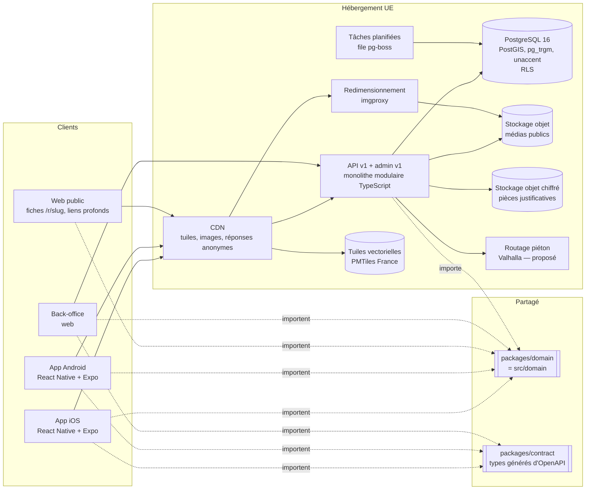

# 08 — Architecture technique

Ce document propose l'architecture cible de YallaYum et justifie chaque choix : applications mobiles, back-end, données, carte, sécurité, vie privée, performance, qualité et exploitation. Il ne suppose rien de la technologie de l'application historique (non auditée ici) : c'est une reconstruction. Il s'appuie sur ce qui existe déjà dans ce dépôt et a été vérifié :

| Brique | Fichier | État |
|---|---|---|
| Socle métier TypeScript sans dépendance navigateur | `src/domain/*` | 67 tests (`npm test`) |
| Schéma PostgreSQL 16 + PostGIS | `db/schema.sql` | 104 vérifications sur une vraie base (`npm run test:sql`) |
| Contrat d'API | `api/openapi.yaml` | OpenAPI 3.1, API publique et API d'administration |
| Prototype mobile web | `src/app/*` | Preact 11 + Vite 8, MapLibre GL JS 5.24 |
| Style de carte et tuiles | `src/map/*`, `scripts/tiles.mjs`, `scripts/pack.mjs` | Schéma OpenMapTiles, clair et sombre |

---

## 1. Vue d'ensemble



Principe directeur : **un monolithe modulaire et un seul socle métier**, pas de microservices tant que l'équipe tient dans une pièce. La complexité de YallaYum est dans les règles (confiance halal, horaires, classement, fidélité), pas dans la charge : il faut que ces règles soient écrites une fois.

---

## 2. Applications mobiles

### 2.1 Comparaison

| Critère | React Native + Expo | Flutter | Natif (Swift + Kotlin) |
|---|---|---|---|
| Carte MapLibre avec notre style | `@maplibre/maplibre-react-native` (MapLibre Native en dessous) ; nécessite un build de développement Expo, pas Expo Go | Greffon `maplibre_gl` (communautaire) | MapLibre Native iOS et Android, accès complet |
| Apple Plans / Google Maps | `react-native-maps` | `google_maps_flutter`, greffons Apple | MapKit, Google Maps SDK |
| Partage du socle métier | **Direct** : `src/domain` s'importe tel quel (TypeScript pur, testé) | Réécriture en Dart, puis double maintenance avec l'API TypeScript | Triple réécriture (Swift, Kotlin, serveur) |
| Partage avec l'API et le back-office | Même langage, mêmes types générés depuis `api/openapi.yaml` | Non | Non |
| Accessibilité | Rôles, libellés, taille de police système (`allowFontScaling`) ; bon niveau, à tester écran par écran | Arbre sémantique propre ; bon niveau | Le meilleur accès aux API système |
| Performance carte et gestes | Rendu natif de la carte ; feuille à trois hauteurs avec `react-native-reanimated` et `react-native-gesture-handler` sur le fil d'interface | Moteur de rendu propre, très fluide | Référence |
| Mises à jour | Builds EAS, mises à jour du code JS hors store dans le cadre des règles des stores | Store uniquement | Store uniquement |
| Recrutement en France | Large vivier TypeScript / React | Plus restreint | Deux profils distincts |
| Coût d'une équipe minimale | 1 base de code mobile | 1 base de code + duplication du domaine | 2 bases de code + duplication |

### 2.2 Le socle partagé, concrètement

`src/domain` ne dépend ni du DOM ni d'une plateforme. Les mêmes fonctions servent partout :

| Fonction | App mobile | API | Back-office |
|---|---|---|---|
| `deriveHalalStatus()` | Badge et bloc « Information halal » | Champ `halal.level` des réponses | Files de vérification |
| `openStatus()` | « Ouvert · jusqu'à 02:00 » | Filtre « ouvert maintenant » | Aperçu de fiche |
| `interpret()`, `autocomplete()` | Puces « Compris : » hors ligne | `/v1/search/interpret`, `/v1/search/suggest` | — |
| `rank()`, `insertSponsored()`, `diagnose()` | Classement local hors ligne | Classement des candidats renvoyés par PostGIS | Prévisualisation des poids |
| `earn()`, `verifyCardToken()` | — | `/v1/loyalty/merchant/scan` | Fraude, annulations |
| `can()`, `transition()` | — | Garde de chaque route | Affichage des seuls boutons autorisés |
| `buildEvent()` | Filtrage des propriétés avant envoi | Validation à la réception | — |

Une règle modifiée (ex. durée de validité d'une déclaration) change en un seul endroit, testée une fois, et la base la reproduit (fonctions SQL `halal_status()`, `open_status()` alignées sur le même jeu de tests). Les écarts assumés entre TypeScript et SQL sont listés dans `05-donnees.md`.

### 2.3 Recommandation

**React Native + Expo**, en dépôt unique :

```
apps/mobile      React Native + Expo (Expo Router, build de développement)
apps/api         API TypeScript
apps/admin       back-office web
packages/domain  = src/domain actuel
packages/contract  types générés depuis api/openapi.yaml (openapi-typescript)
packages/map-style = src/map/style.ts (JSON de style MapLibre partagé web/mobile)
```

Le prototype web (`src/app`) sert de spécification d'interaction : feuille à trois hauteurs, carrousel synchronisé, morphing de la vignette vers la fiche, états. Il ne se porte pas tel quel (Preact/DOM), mais sa logique d'état (`src/app/state.ts`) se transpose presque ligne à ligne.

Le natif ne se justifierait que si un test sur appareil montrait une limite de MapLibre React Native inacceptable (rendu de centaines de marqueurs animés, mémoire). Mesure à faire dès le premier sprint : 300 marqueurs, déplacement de carte, ouverture de la feuille, sur un Android milieu de gamme.

---

## 3. Back-end

### 3.1 Monolithe modulaire

API TypeScript sur Node.js. **NestJS (adaptateur Fastify)** recommandé : ses modules correspondent aux domaines métier et imposent des frontières ; Fastify seul est plus léger mais laisse l'organisation à la discipline de l'équipe.

| Module | Responsabilité | Tables principales |
|---|---|---|
| Catalogue | Fiches, enseignes, horaires, médias, taxonomies, liens profonds | `restaurants`, `brands`, `opening_hours`, `special_days`, `media`, `cuisines`… |
| Recherche et carte | Zone, filtres, classement, grappes, suggestions, géocodage | `search_restaurants()`, `cluster_restaurants()` |
| Identité | Comptes, appareils, consentements, export, suppression | `users`, `devices`, `consents`, `delete_account()` |
| Contenus | Collections, guides, programmation | `editorial_*`, `publication_schedule` |
| Confiance halal | Preuves, organismes, revue, expiration, pièces | `halal_claims`, `halal_evidence_documents`, `review_tasks` |
| Contributions | Propositions, signalements, modération, propositions de modification | `contributions`, `change_proposals` |
| Fidélité | Programme, cartes, scans, grand livre, bons, litiges | `loyalty_*`, `vouchers`, `disputes` |
| Partenaires | Revendication de fiche, rattachements, statistiques agrégées | `partners`, `merchant_memberships` |
| Administration | Rôles, MFA, journal d'audit, imports | `admin_users`, `audit_logs`, `role_permissions` |
| Mesure | Réception et validation des événements, purge | `analytics_events`, `purge_analytics()` |

Un module n'accède qu'à ses tables ; il appelle les autres par leur interface. Un module pourra sortir en service séparé le jour où une contrainte réelle l'exige (charge du scan fidélité, par exemple), pas avant.

### 3.2 API et contrats

- `/v1` (public) et `/admin/v1` (back-office), décrits dans `api/openapi.yaml` : explorer sans compte, erreurs RFC 9457 en français, pagination par curseur, limitation de débit par catégorie.
- Types clients générés depuis le contrat ; validation des entrées à la frontière (schémas dérivés du contrat).
- Versionnement : ajouts non cassants dans `/v1` ; tout retrait passe par `/v2` avec six mois de recouvrement. Les applications envoient leur version ; l'API peut demander une mise à jour obligatoire.

### 3.3 Données

- **PostgreSQL 16 + PostGIS**, extensions `pg_trgm`, `unaccent`, `citext` (`db/schema.sql`). Migrations SQL versionnées, appliquées par la CI, jamais à la main.
- **Recherche textuelle** : `pg_trgm` + `unaccent` (index trigramme sur `normalized_name`) d'abord. Un moteur dédié (Meilisearch, Typesense) seulement si la mesure montre un besoin réel : latence p95 hors budget, pertinence insuffisante sur un panel de requêtes, ou volume multi-pays.
- **Cache** : CDN pour les réponses anonymes, invalidation par version du catalogue (`06-recherche-classement.md` § 5.5) ; Redis seulement si un besoin mesuré apparaît.
- **File de tâches** : `pg-boss` (file dans PostgreSQL) pour rester sur une seule base. Tâches : contrôle quotidien `expire_halal_claims()`, `purge_analytics()`, imports, génération des variantes d'images, rappels de revérification.

### 3.4 Médias

- Stockage objet compatible S3 hébergé dans l'UE, deux espaces : **public** (photos dont les droits sont validés, `rights_status = cleared`) et **privé chiffré** (pièces justificatives halal).
- Redimensionnement à la volée (imgproxy, open source) derrière le CDN : formats modernes, tailles par usage (vignette liste, carrousel, galerie).
- Aucune image publiée sans crédit, licence et statut de droits. Les visuels génératifs sont étiquetés « Illustration ».

### 3.5 Back-office

Application web séparée, même socle et mêmes contrats. Deux voies :

| Option | Pour | Contre |
|---|---|---|
| Next.js | Écosystème large, rendu serveur, authentification mûre | Plus lourd ; architecture à apprendre |
| Base actuelle (Preact + Vite, `src/admin`) | Déjà branchée sur `src/domain`, légère | Moins d'outillage prêt à l'emploi |

Recommandation : partir de l'admin actuelle pour le MVP interne, réévaluer quand l'espace restaurateur ouvre au public (rendu serveur, SEO inutile, mais exigences d'authentification et de support plus fortes).

### 3.6 Indicateurs de fonctionnalités

Drapeaux côté serveur, lus au démarrage de l'app et par l'API : `loyalty.enabled` (désactivé par défaut tant que l'audit du module n'est pas fait), `sponsored.enabled`, `routing.eta`, `search.engine`. Un drapeau ne remplace jamais une vérification de droits.

### 3.7 Environnements et infrastructure

- **dev** (local : `docker compose` PostgreSQL + PostGIS, données de démonstration), **staging** (copie anonymisée ou données fictives, mêmes versions), **prod**.
- Infrastructure décrite en code (Terraform ou OpenTofu) ; aucune ressource créée à la main.
- **Hébergement dans l'UE**, de préférence chez un hébergeur soumis au seul droit européen. Candidats à comparer : Scaleway, OVHcloud, Clever Cloud (PaaS), ou AWS région Paris. Critères : PostgreSQL managé avec PostGIS (à vérifier par fournisseur), sauvegardes à un instant donné, stockage objet, CDN, coût.

---

## 4. Fournisseur de carte

Le prototype utilise **MapLibre GL JS 5.24** avec des tuiles au schéma **OpenMapTiles** servies par **OpenFreeMap**, et un style maison (`src/map/style.ts`) : carte calme, sans commerces concurrents, eau couleur lagon, stations comme repères, variantes jour et nuit. Pour l'artefact en fichier unique, `scripts/tiles.mjs` filtre les tuiles de Paris et de la proche couronne (zooms 10 à 14, 203 tuiles) : **55,3 Mo bruts → 4,46 Mo** après filtrage des couches et des traductions de noms ; avec les polices de libellés, le paquet fait **4,96 Mo, soit 3,27 Mo en base64 compressé** (`scripts/pack.mjs`).

Note de version : MapLibre GL JS 6 n'est plus livré qu'en modules ES avec un worker séparé, incompatible avec un artefact en fichier unique (workers d'une autre origine interdits) ; le prototype reste sur la branche 5.x. Sans incidence pour l'app mobile (MapLibre Native).

| Option | Coût | Licence et réutilisation | Qualité France | Style | Hors ligne |
|---|---|---|---|---|---|
| OpenFreeMap (instance publique) | Gratuit, sans clé | Données ODbL, schéma OpenMapTiles (attribution) | OSM : très bonne en ville | Style libre (le nôtre) | Non (serveur public), sans engagement de service |
| OpenMapTiles auto-hébergé en **PMTiles** (un fichier France sur stockage objet + CDN) | Stockage + bande passante CDN ; pas de coût par vue | Idem ; génération avec Planetiler | Idem | Libre | **Oui** : extraits PMTiles par zone |
| MapTiler Cloud | Abonnement selon volume (tarif à vérifier) | Compatible MapLibre ; conditions de cache à lire | Bonne | Libre (schéma OpenMapTiles) | Selon offre |
| Mapbox | Facturation à l'usage (chargements web, utilisateurs actifs mobiles ; tarif à vérifier) | SDK propriétaire depuis la v2 ; conditions de mise en cache restrictives | Bonne | Studio puissant | Selon offre |
| Google Maps | À l'usage (tarif à vérifier) | Conditions strictes ; interdiction de reconstituer une base à partir de leurs données | Très bonne, mais commerces concurrents partout | Personnalisation limitée | Limité |
| Apple MapKit | Inclus sur iOS dans des quotas (à vérifier) | iOS seulement : il faudrait une autre carte sur Android | Bonne | Personnalisation limitée | Non |

**Recommandation** : rester sur MapLibre et le schéma OpenMapTiles, avec le style maison partagé web/mobile. Lancer avec un fournisseur géré (MapTiler, ou OpenFreeMap tant que l'audience est faible et qu'un repli est prévu), puis passer à des **PMTiles France auto-hébergés** derrière le CDN : coût prévisible, aucune dépendance à un tarif par vue, cartes hors ligne possibles par zone. Le style ne change pas en changeant de fournisseur. L'attribution OpenStreetMap reste visible sur la carte (bouton « i » repliable).

Ce qui ne se fait pas : extraire des données de Google ou d'une autre plateforme pour enrichir le catalogue. La base a été construite à la main et s'enrichit par l'équipe, les restaurateurs et les contributions modérées.

---

## 5. Sécurité

| Sujet | Mesure |
|---|---|
| Droits | Vérifiés côté serveur à chaque route avec `can()` (`src/domain/rbac.ts`), et en base par la sécurité au niveau des lignes : un restaurateur ne lit que ses établissements et ses transactions (`restaurants_owner`, `loyalty_owner`). L'interface ne fait que refléter. |
| MFA | Obligatoire pour les rôles internes ; les droits sensibles (`restaurant.publish`, `halal.review`, `halal.evidence.read`, `loyalty.adjust`, `user.manage`, `import.run`, `privacy.requests`) sont refusés sans session MFA (code et base, `sensitive_permissions`). Clés matérielles ou TOTP. |
| Comptes internes | Invitation nominative, révocation immédiate, revue trimestrielle des accès, aucun compte partagé. |
| Secrets | Gestionnaire de secrets de l'hébergeur ; aucun secret dans les applications ni dans le dépôt ; rotation documentée. Les jetons de carte de fidélité sont signés côté serveur (HMAC-SHA256, secret par carte) ; le signataire du prototype (`demoSigner`) est explicitement non cryptographique. |
| Débit | Par catégorie (`api/openapi.yaml`) : anonyme 120 req/min par IP, connecté 300, contributions 10/h par appareil, scan commerçant 30/min par appareil, admin 600/min. |
| Entrées | Validation de schéma à la frontière, requêtes paramétrées, tailles maximales (message de contribution ≤ 2 000 caractères), garde anti-liens (`validateSubmission`). |
| Pièces justificatives | Espace privé chiffré, accès réservé à `halal.evidence.read`, liens signés de quelques minutes, empreinte SHA-256 conservée, chaque consultation journalisée. |
| Journal d'audit | Ajout seul, chaîné par empreintes SHA-256, UPDATE/DELETE/TRUNCATE refusés en base. |
| Journaux techniques | Sans données personnelles (pas d'e-mail, pas de coordonnées, pas de requête brute) ; rétention courte. |
| Sauvegardes | Restauration à un instant donné ; exercice de restauration chronométré chaque trimestre sur staging, avec objectif de reprise écrit. Une sauvegarde jamais restaurée n'est pas une sauvegarde. |
| Plantages | Outil de suivi des plantages hébergé dans l'UE ou auto-hébergé, avec nettoyage des données personnelles avant envoi. |
| Dépendances | Versions épinglées, mises à jour régulières, analyse de vulnérabilités en CI. |

---

## 6. Vie privée dès la conception

### 6.1 Le point sensible

Fréquenter des restaurants halal peut révéler une conviction religieuse, donnée sensible au sens de l'article 9 du RGPD. L'étiquette de confidentialité actuelle de l'App Store déclare une localisation et des identifiants « utilisés pour vous suivre » et des publicités tierces (voir `01-produit.md`). La refonte retient :

- **aucun SDK publicitaire**, aucun partage ni revente de données, aucun identifiant publicitaire ;
- **aucune position précise envoyée au serveur** pour la mesure (`distanceBucket()`), aucune position conservée ;
- **analyse d'impact (AIPD) recommandée** avant lancement, avec le DPO.

### 6.2 Finalités et bases légales

| Traitement | Finalité | Base légale proposée | Conservation proposée |
|---|---|---|---|
| Position | Trier par distance, à la demande | Consentement (permission système demandée au moment utile) | Non conservée côté serveur |
| Compte | Synchroniser favoris, collections, carte | Contrat | Jusqu'à suppression |
| Historique de recherche | Reproposer ses recherches | Consentement, effaçable | Sur l'appareil ; côté compte, 120 caractères max par entrée |
| Mesure d'audience exemptée | Fonctionnement et amélioration | Intérêt légitime, dans le cadre d'exemption de la CNIL | 25 mois |
| Mesure détaillée | Impressions, classement | Consentement | 13 mois |
| Texte des recherches sans résultat | Couverture et lexique | Intérêt légitime | 90 jours |
| Contributions | Corriger le catalogue | Intérêt légitime | Anonymisées à la suppression du compte |
| Fidélité | Programme | Contrat | Grand livre conservé et détaché à la suppression (obligations comptables à confirmer) |

Les durées viennent d'`app_config` et de `src/domain/privacy.ts` ; elles sont à valider par le DPO.

### 6.3 Règles de produit

- Explorer sans compte ; aucune question sur la religion, l'âge, le genre ; aucune préférence déduite du comportement.
- Pas de suivi en arrière-plan, pas de géorepérage, pas de notification déclenchée par la position.
- Consentements enregistrés avec finalité, base légale et version du texte (`consents`).
- Export en un geste (JSON) ; suppression de compte depuis l'app (exigée par l'App Store), avec le plan détaillé de ce qui est effacé, anonymisé, conservé (`planAccountDeletion`, `delete_account()`).
- **Mineurs** : la fiche App Store actuelle indique 16+. En France, le consentement d'un mineur au traitement de ses données pour un service en ligne est valable à partir de 15 ans. Proposition : pas de collecte supplémentaire pour les mineurs, aucune publicité, et une réévaluation de la classification d'âge avec le juriste.
- **SDK tiers** : liste fermée, revue à chaque ajout (finalité, données envoyées, pays). Par défaut : carte, suivi des plantages, authentification Apple/Google. Rien d'autre.

---

## 7. Performance

Aucun temps n'est garanti avant mesure. Budgets **proposés**, à mesurer sur un Android milieu de gamme et un iPhone de 3 ans, réseau 4G dégradé :

| Moment | Budget proposé |
|---|---|
| Lancement à froid → carte interactive avec premiers marqueurs | < 2,5 s |
| Recherche (serveur, p95) | < 300 ms |
| Recherche perçue (geste → liste à jour, p95) | < 800 ms |
| Ouverture d'une fiche depuis une carte de résultat | < 300 ms jusqu'à l'image, contenu complet < 1 s |
| Gestes (feuille, carrousel, carte) | 60 images/s, aucune image perdue au relâcher |
| Taille de l'app | À fixer après le premier build |

Moyens : réponses compactes et paginées, images aux bonnes dimensions et chargées à la demande, cache CDN, carte vectorielle, grappes, calculs de classement côté serveur, mesures de performance dans la CI sur appareils réels (laboratoire d'appareils ou parc interne).

### Mode dégradé

| Situation | Comportement |
|---|---|
| Hors ligne | Derniers résultats et fiches des favoris affichés avec leur date (« peut-être anciens ») ; contributions mises en file et envoyées au retour du réseau. |
| Carte indisponible | Écran explicite et liste complète (état « Carte indisponible pour le moment », prototype). |
| Position indisponible ou refusée | Choix d'une ville, jamais d'écran bloquant. |
| Routage indisponible | Distance à vol d'oiseau, comme aujourd'hui. |

---

## 8. Qualité

| Niveau | Outil | Ce qui existe |
|---|---|---|
| Unitaires du socle | Vitest | 67 tests dont les 18 cas de recette du cahier des charges (`recette.test.ts`) |
| Base de données | Script `db/run-tests.sh` sur un cluster jetable PostGIS | 104 vérifications : minuit, expiration halal, idempotence fidélité, RLS, conflit de version, audit |
| Composants mobiles | React Native Testing Library | À créer |
| Bout en bout web | Playwright (déjà installé dans l'environnement) | Parcours du prototype (`e2e/`) |
| Bout en bout mobile | Maestro (scénarios lisibles) ou Detox | À créer, mêmes scénarios Given/When/Then |
| Accessibilité | Lecteurs d'écran sur appareil, police 200 %, contraste | Vérifié sur le prototype : 200 %, sombre, mouvement réduit |
| Contrat | Validation d'`api/openapi.yaml` (Redocly) et tests de conformité des réponses | Contrat valide (avertissements à traiter) |

**CI/CD** : à chaque demande de fusion, vérification des types, tests unitaires, tests SQL dans un conteneur PostGIS, validation du contrat, build. Sur la branche principale : déploiement staging automatique, production sur validation. Mobile : builds EAS, distribution **TestFlight** et **tests internes Google Play**, puis déploiement progressif en production (pourcentage d'utilisateurs).

**Observabilité** : traces OpenTelemetry de l'API (latence par route, requêtes SQL lentes), métriques métier (zéro résultat, intentions de visite), sessions sans plantage, alertes sur erreurs 5xx, latence p95, échec du contrôle quotidien halal. Tableau de bord d'exploitation séparé des tableaux de bord produit (`09-mesure.md`).

---

## Décisions à prendre

1. **Plateforme mobile** : React Native + Expo recommandé ; confirmer après le test de 300 marqueurs sur Android milieu de gamme.
2. **Cadre de l'API** : NestJS (adaptateur Fastify) ou Fastify seul.
3. **Back-office** : poursuivre la base Preact actuelle ou migrer vers Next.js avant l'ouverture de l'espace restaurateur.
4. **Hébergeur UE** : comparer Scaleway, OVHcloud, Clever Cloud et AWS Paris sur PostGIS managé, sauvegardes, coût.
5. **Fournisseur de tuiles** au lancement (MapTiler ou OpenFreeMap) et date de bascule vers des PMTiles auto-hébergés.
6. **Moteur de recherche dédié** : non au MVP ; critères de bascule à fixer (latence, pertinence, volume).
7. **Outil de suivi des plantages** compatible avec l'absence de données personnelles et l'hébergement UE.
8. **AIPD** et validation par le DPO des durées de conservation et des bases légales ; classification d'âge de l'app.
9. **Budgets de performance** : adopter les valeurs proposées comme objectifs provisoires, à réviser après la première mesure.
